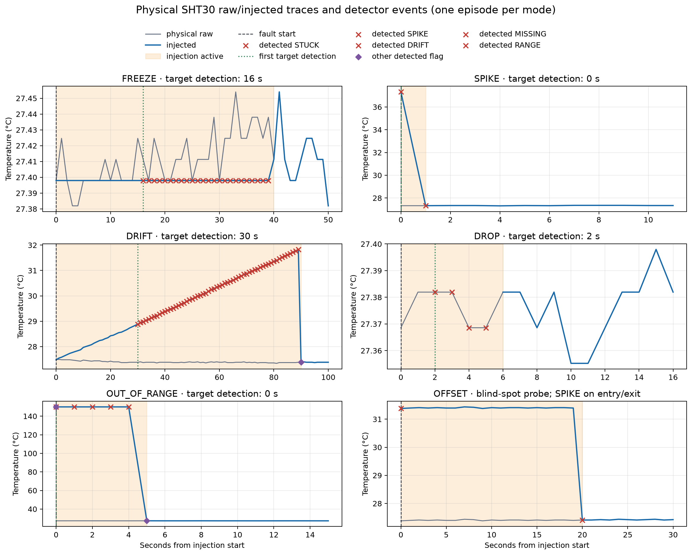
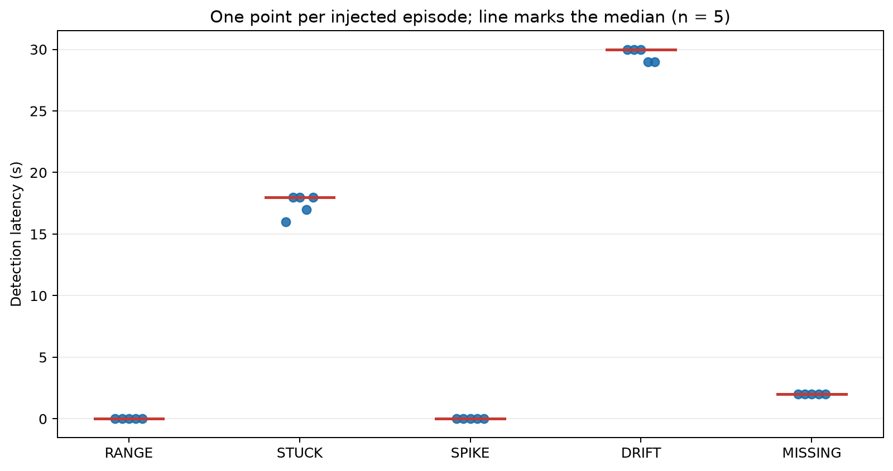
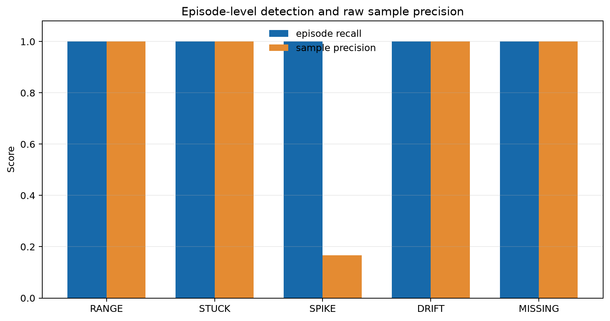
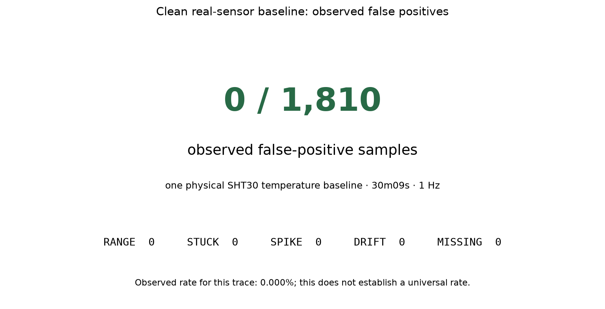

<h1 align="center">SensorTrust</h1>

<p align="center"><strong>可移植 C11 传感器健康检测</strong></p>

<p align="center">故障检测 · 健康评分 · 真实传感器证据</p>

---

<p align="center">
  <a href="#project-overview">概览</a> ·
  <a href="#检测方法">方法</a> ·
  <a href="#实现与硬件状态">验证状态</a> ·
  <a href="#relationship-to-smart-agriculture-edge-ai">主项目关联</a> ·
  <a href="README.md">English</a>
</p>

---

<a id="project-overview"></a>

SensorTrust 是面向单个传感器通道的可移植 C11 健康检测核心。它将带时间戳的读数转换为故障标志、严重程度评分，以及 `HEALTHY`、`DEGRADED` 或 `FAULT` 状态。v0.2 在真实 ESP32-S3 + SHT30 温度读数上叠加确定性软件故障注入，评估语义已冻结的 v0.1 检测器。

## 研究问题

节点能否在读数进入控制或遥测流程前识别可疑数据？传感器可能持续输出看似合理的数值，但其输出已经冻结、漂移或存在偏差。SensorTrust 只评估调用方提供的读数；采样和上传由外围系统决定。

## 检测方法

```text
数值 + 有效性 + 时间戳
    → 各通道独立的 C11 检测器
    → 故障位掩码 + health_score（0..100）+ 健康状态
```

| 标志 | 位 | 检测什么 | 默认触发条件 |
| --- | --- | --- | --- |
| `FAULT_RANGE` | `1 << 0` | 物理上不可能的值 | `value < min_value` 或 `value > max_value` |
| `FAULT_STUCK` | `1 << 1` | 通道停止变化 | 最近 `stuck_window` 个采样的 `max - min < stuck_epsilon` |
| `FAULT_SPIKE` | `1 << 2` | 突然跳变 | `abs(value - 上一个有效值) > spike_threshold` |
| `FAULT_DRIFT` | `1 << 3` | 持续的单向趋势 | 连续 `drift_window` 个采样 `abs(slope) > drift_threshold`，slope 单位为**每秒**变化量 |
| `FAULT_MISSING` | `1 << 4` | 没有可用读数 | 连续 `missing_limit` 个无效采样 |

检测器相互独立，一个样本可携带多个标志。STUCK 检查完整窗口，而非仅比较相邻值是否相等。SPIKE 报告突变并可确认回到原水平的尖峰；持续阶跃随后被接受为新水平。DRIFT 对时间戳进行最小二乘拟合，以每秒变化量衡量斜率，但确认仍要求连续多个样本。STUCK 和确认窗口按样本数计，因此实际持续时间随采样间隔改变。

评分从 100 开始扣除活动故障的罚分：RANGE/MISSING 各 55、STUCK 35、SPIKE/DRIFT 各 25，并截断至 0..100。80..100 对应 `HEALTHY`，50..79 对应 `DEGRADED`，0..49 对应 `FAULT`。评分是启发式严重程度，不是标定概率，也不证明传感器物理损坏。

## 主要发现

1 Hz 实验先采集真实 SHT30 数据，再软件注入故障，并非物理损坏传感器。25 个目标故障轮次全部检出，中位检测延迟如下：

| 故障 | 检出轮次 | 中位检测延迟 |
| --- | ---: | ---: |
| RANGE | 5/5 | 0 s |
| STUCK | 5/5 | 18 s |
| SPIKE | 5/5 | 0 s |
| DRIFT | 5/5 | 30 s |
| MISSING | 5/5 | 2 s |

正常基线包含 30m09s 内的 1,810 个样本，观察到 0 个误报样本、0 次物理读取失败。这次观察不能证明普遍的零误报率。轮次全部检出也不等于逐样本召回率为 100%：确认延迟降低了 STUCK、DRIFT 和 MISSING 的逐样本召回率。

**已测得的盲点：** 稳定的 +4 °C OFFSET 偏移不被识别。进入与撤除边界分别在 5/5 轮中触发 SPIKE，但 OFFSET 不是第六种检测器，也不计入目标召回率。

原有四张渲染图、逐样本指标及评估定义完整保留在[详细评估](#详细评估)。完整过程见[真机证据报告](results/v0.2/README.md)与[硬件实验流程](hardware/README.md)。

### 实验渲染图









## 实现与硬件状态

- 主机回放和 ESP32 固件共享 [core/sensor_trust.c](core/sensor_trust.c)。核心使用固定的 64 点有效样本环形缓冲区，更新复杂度为 `O(window)`，不分配堆内存，不依赖 RTOS、网络、stdio 或硬件头文件。
- 各通道有独立配置与上下文，输入为 `value`、`valid` 和 `timestamp_ms`；无效读数由 MISSING 处理。类型与配置见[公开 C API](core/sensor_trust.h)。
- ESP-IDF v5.4.4 固件读取真实 SHT30（I²C 地址 `0x44`，SDA GPIO 8 / SCL GPIO 9），温度经过独立确定性注入器后进入相同核心。启动检查 I²C、CRC 和数值合理性。
- 已评估温度；驱动读取湿度但未评估，BH1750 未测试。加速的 1 Hz 实验室计划不是部署采样间隔。

## 快速开始与复现

主机回放需要 Python 和 C11 编译器，在仓库根目录执行：

```bash
python3 -m venv .venv
source .venv/bin/activate
python -m pip install -r requirements-dev.txt
python simulator/generate.py
python simulator/run.py
python -m pytest tests/ -v
```

Python 只生成场景和汇总结果；`simulator/run.py` 编译并回放实际 C 核心。七个合成场景的结果保存在 [results/scenarios.csv](results/scenarios.csv)，与真机证据分开。

固件需要 ESP-IDF 环境以及[硬件指南](hardware/README.md)中的 SHT30 接线：

```bash
cd firmware
idf.py set-target esp32s3
idf.py build
```

串口采集、评估和绘图流程见硬件指南。`hardware/render_readme.py` 从记录的 CSV/JSON 证据更新带标记的双语结果区域。

## Relationship to Smart-Agriculture-Edge-AI

[Smart-Agriculture-Edge-AI](https://github.com/Sver0411/Smart-Agriculture-Edge-AI) 复用了 SensorTrust 的传感器健康检测语义和核心实现。SensorTrust 保持独立的单通道检测器定位，由主系统负责调度、通信和控制决策。

## 局限与后续工作

- 单通道难以区分传感器故障与真实环境变化：稳定环境可能表现为 STUCK，真实趋势可能表现为 DRIFT。阈值为手工设定的默认值。
- 量程内恒定偏移仍是盲点。参考传感器、跨通道核验和更广泛的环境验证属于后续方向。
- 真机证据仅覆盖一个温度通道、一次采集；仍需更多传感器、部署间隔和更长正常基线来评估泛化。
- 推送式 API 无法发现完全停止调用 `sensor_trust_update()` 的设备，超时由调用方监测。窗口内时间戳未严格递增时，该窗口不评估 DRIFT，不新增故障类型。

## 详细评估

下方自动生成区域保留原始测量表格与全部渲染图，开始和结束标记供更新脚本使用。

<details>
<summary>展开自动生成的详细指标与原始评估定义</summary>

<!-- V0.2_RESULTS_START -->
## v0.2 真机评估（由原始串口日志生成）

硬件：ESP32-S3 + SHT30；评估通道：`temperature_C`；采样率：本实验 1 Hz。
正常真实数据基线：1,810 个样本 / 30m09s；本次观察到误报样本 0 / 1,810（0.000%），物理读取失败 0。这只描述本次观察，不代表普遍的零误报率。

注入 5 类目标故障，每类 5 轮：目标 episode 共 25/25 检出；OFFSET 是盲点探针，不计入五类目标召回率。

| 故障 | Episodes | 检出 | Episode recall | 中位检测延迟 | 观测范围 | 中位恢复延迟 |
| --- | ---: | ---: | ---: | ---: | ---: | ---: |
| RANGE | 5 | 5 | 100% | 0 s | 0 s–0 s | 0 s |
| STUCK | 5 | 5 | 100% | 18 s | 16 s–18 s | 0 s |
| SPIKE | 5 | 5 | 100% | 0 s | 0 s–0 s | 1 s |
| DRIFT | 5 | 5 | 100% | 30 s | 29 s–30 s | 0 s |
| MISSING | 5 | 5 | 100% | 2 s | 2 s–2 s | 0 s |

### 逐样本多标签指标

| 故障 | TP | FP | TN | FN | Precision | Recall | F1 |
| --- | ---: | ---: | ---: | ---: | ---: | ---: | ---: |
| RANGE | 25 | 0 | 4245 | 0 | 1.000 | 1.000 | 1.000 |
| STUCK | 113 | 0 | 4070 | 87 | 1.000 | 0.565 | 0.722 |
| SPIKE | 35 | 0 | 4235 | 0 | 1.000 | 1.000 | 1.000 |
| DRIFT | 302 | 0 | 3820 | 148 | 1.000 | 0.671 | 0.803 |
| MISSING | 20 | 0 | 4240 | 10 | 1.000 | 0.667 | 0.800 |

`injection_mode` 表示实验施加原因；`expected_observable_flags` 是依据注入信号、有效性、实验 schedule、冻结配置和已公开 detector 定义独立生成的多标签 truth。生成 truth 时不读取 detector 输出。一个样本可以同时为 RANGE 和 SPIKE。

旧版 SPIKE 的 25 个 FP 均是合法可观测边界：SPIKE recovery 5, DRIFT recovery 5, OUT_OF_RANGE recovery 5, OFFSET entry 5, OFFSET removal 5。旧口径还把 OUT_OF_RANGE 进入边界的 5 个 RANGE+SPIKE 样本排除在 SPIKE confusion matrix 外。修正后 SPIKE 为 `TP=35`、`FP=0`、`FN=0`；本组正式数据没有 genuine SPIKE false positive。

| 原注入原因 | 阶段 | 可观测 SPIKE 样本 | 检出 | 旧口径 FP 数 |
| --- | --- | ---: | ---: | ---: |
| DRIFT | RECOVERY | 5 | 5 | 5 |
| OFFSET | INJECTION | 5 | 5 | 5 |
| OFFSET | RECOVERY | 5 | 5 | 5 |
| OUT_OF_RANGE | INJECTION | 5 | 5 | 0 |
| OUT_OF_RANGE | RECOVERY | 5 | 5 | 5 |
| SPIKE | INJECTION | 5 | 5 | 0 |
| SPIKE | RECOVERY | 5 | 5 | 5 |

OFFSET 是 non-target blind-spot probe：恒定 +4 °C 平台没有 OFFSET detector；进入边界 5/5、撤除边界 5/5 触发 SPIKE。稳定偏移本身不被识别。

STUCK、DRIFT 和 MISSING 的 sample-level recall 包含故障开始后、达到确认条件前的刻意确认窗口。MISSING `missing_limit=3`，前三个 invalid 样本都按可观测 MISSING truth 计；前两个尚未确认的样本因此是 FN，不是 episode miss。

Clean baseline 观察到 0 / 1,810 个误报样本（30m09s）。Observed sample rate 为 0.000%；这不能证明普遍的零误报率。

硬件容量：物理 Flash 16 MiB（`esptool.py flash_id`）；固件配置 2 MiB、image header 2 MiB、固件报告 2 MiB。ESP32-S3 芯片/封装识别报告 embedded PSRAM 8 MiB（不是内存测试）；本固件未启用 PSRAM，运行时可用 0 bytes。

图表（由 CSV/JSON 生成）：


测量固件 commit `6e043c98544d8682371bad9b7b3a2e99c7189696`（git_dirty=false）；配置 SHA-256 `9a1461beb37f50ae4958950222feea186b1f3509c4fcf60de19f5c3606c1da6e`；编译器 `xtensa-esp-elf-gcc (crosstool-NG esp-14.2.0_20260121) 14.2.0`。原始日志 `results/v0.2/raw/sht30_temperature_v02_20260923T111155Z.log`，SHA-256 `80f8a6d4744784e44f35b9c4f0f29d1cf41d764d6c399f99bb1fe71eae746044`。
结果文件：[sample_results.csv](results/v0.2/sample_results.csv)、[fault_episodes.csv](results/v0.2/fault_episodes.csv)、[metrics_per_fault.csv](results/v0.2/metrics_per_fault.csv)、[cross_fault_detections.csv](results/v0.2/cross_fault_detections.csv)、[hardware_metadata.json](results/v0.2/hardware_metadata.json)。
SHT30 `temperature_C` 已评估；`humidity_percent` 由驱动读取但未评估；BH1750 未测试。
<!-- V0.2_RESULTS_END -->

</details>

## 许可证

MIT — 见 [LICENSE](LICENSE)。
